# Arquitectura de AeroTech (APE 4 – Servicios web con SOA)

Sistema distribuido de reservas de vuelos. Cada diagrama está escrito en Mermaid (archivos `docs/*.mmd`, que GitHub dibuja directamente) y también exportado a PNG en `capturas/diagramas/`.

**Pila:** Flutter (Windows, web y Android) ⇄ HTTPS · JSON/XML ⇄ Flask en Render ⇄ PostgreSQL con SSL ⇄ Supabase.

## 1. Arquitectura SOA

Los consumidores (app Flutter de cliente, app Flutter de administrador, Postman y pytest) usan **los mismos servicios** por HTTPS con JSON (y XML para el comprobante). El backend Flask expone 6 servicios independientes (un Blueprint por servicio) detrás de una capa de seguridad con JWT y roles; la lógica de asientos, precios e historial vive en el servidor y accede a PostgreSQL (Supabase) con transacciones y bloqueos. El contrato OpenAPI describe los 6 servicios.

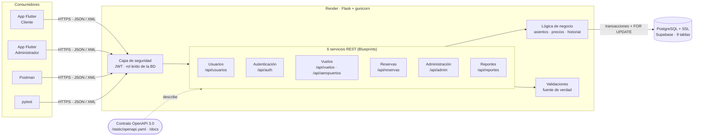

*PNG:* `capturas/diagramas/01_arquitectura_soa.png` · *fuente:* `docs/01_arquitectura_soa.mmd`

## 2. Casos de uso por rol

El cliente busca vuelos, elige asientos en el mapa del avión, reserva, edita, cancela y descarga el comprobante. El administrador gestiona flota, vuelos, reservas y usuarios, y consulta el dashboard. Ambos comparten el registro/inicio de sesión y la consulta de vuelos.

```mermaid
flowchart TB
    CL(["Cliente"])
    AD(["Administrador"])

    subgraph CLI["Casos de uso del cliente"]
        direction TB
        C1("Reservar vuelo<br/>(elige asientos en el mapa del avión<br/>y escribe los datos de cada pasajero)")
        C3("Editar reserva<br/>(asientos, pasajeros y cantidad)")
        C4("Cancelar reserva")
        C5("Descargar comprobante XML")
        C6("Ver historial de la reserva")
        C7("Editar perfil y contraseña")
    end
    subgraph COM["Casos de uso comunes"]
        direction TB
        U1("Registrarse")
        U2("Iniciar y cerrar sesión")
        U3("Consultar vuelos y aeropuertos")
        U4("Ver mapa de asientos")
    end
    subgraph ADM["Casos de uso del administrador"]
        direction TB
        A1("Gestionar flota de aviones")
        A2("Crear, editar y cancelar vuelos")
        A3("Ver manifiesto de pasajeros")
        A4("Ver todas las reservas y cancelarlas")
        A5("Activar, desactivar y cambiar rol<br/>de usuarios")
        A6("Consultar dashboard de indicadores")
    end

    CL --> CLI
    CL --> COM
    AD --> ADM
    AD --> COM
```

*PNG:* `capturas/diagramas/02_casos_de_uso.png` · *fuente:* `docs/02_casos_de_uso.mmd`

## 3. Componentes y capas

Cliente: `screens → services → api_client` (con `models`, `utils` y `sesion` de apoyo). Servidor: `Blueprints → seguridad → validaciones/lógica → db`.

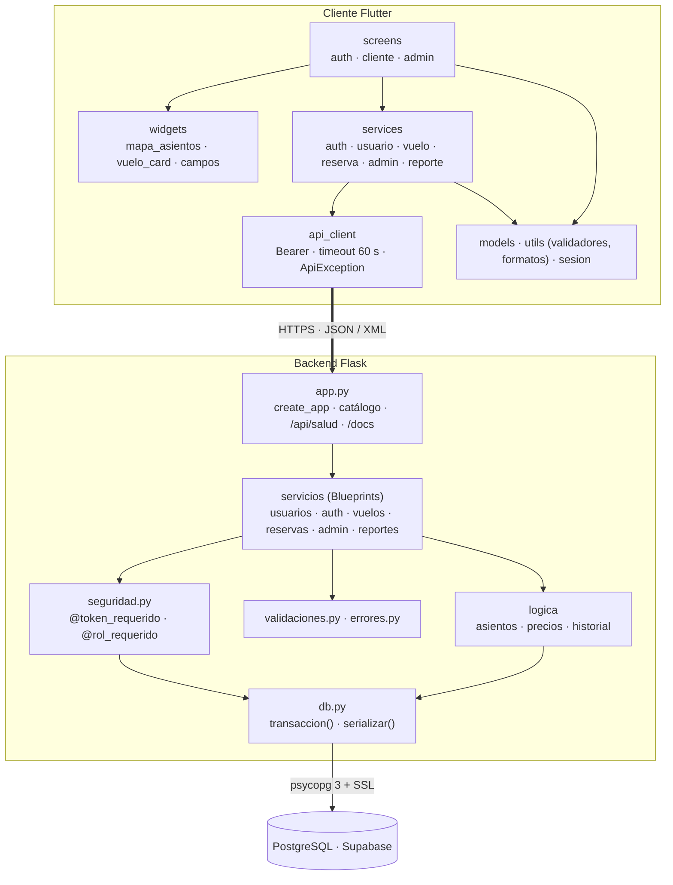

*PNG:* `capturas/diagramas/03_componentes.png` · *fuente:* `docs/03_componentes.mmd`

## 4a. Secuencia: login con JWT

El servidor guarda cada token en la tabla `tokens`; en cada petición se comprueba que siga activo y vigente y se lee el rol y el estado del usuario **de la base de datos** (un cambio de rol o una desactivación aplican de inmediato).

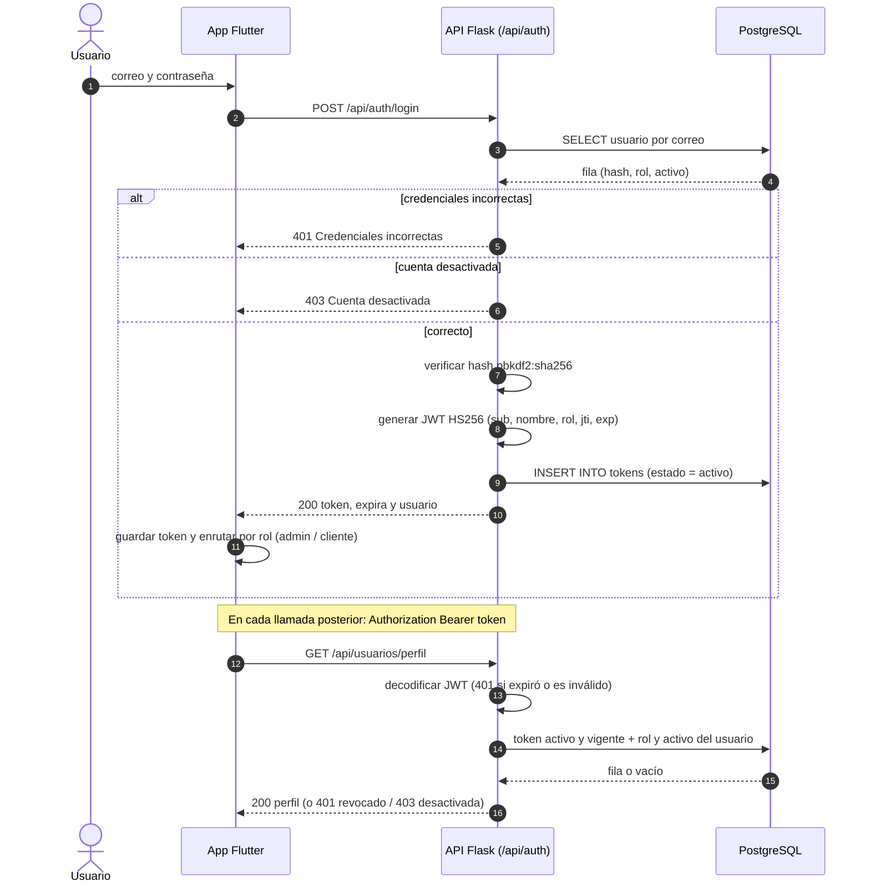

*PNG:* `capturas/diagramas/04a_secuencia_login.png` · *fuente:* `docs/04a_secuencia_login.mmd`

## 4b. Secuencia: crear reserva (concurrencia)

Toda operación que cambia asientos bloquea primero el vuelo (`SELECT ... FOR UPDATE`) dentro de una sola transacción. Si dos clientes piden el mismo asiento, el segundo espera, el `UPDATE ... WHERE estado = 'disponible'` no encuentra la fila y la transacción hace `ROLLBACK` con 409.

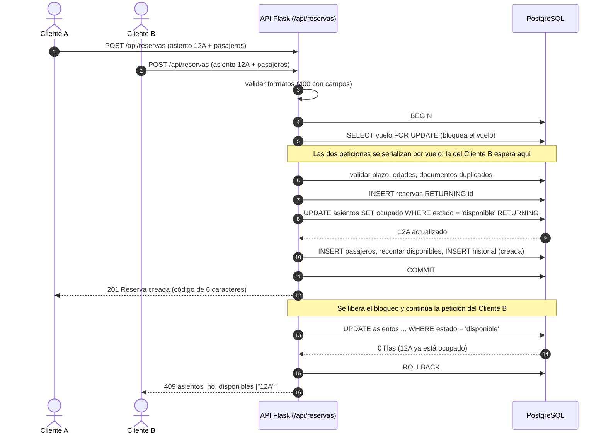

*PNG:* `capturas/diagramas/04b_secuencia_crear_reserva.png` · *fuente:* `docs/04b_secuencia_crear_reserva.mmd`

## 4c. Secuencia: editar reserva

La edición libera los asientos propios y vuelve a ocuparlos en la misma transacción; si algún asiento ya no está libre, el `ROLLBACK` deja la reserva exactamente como estaba.

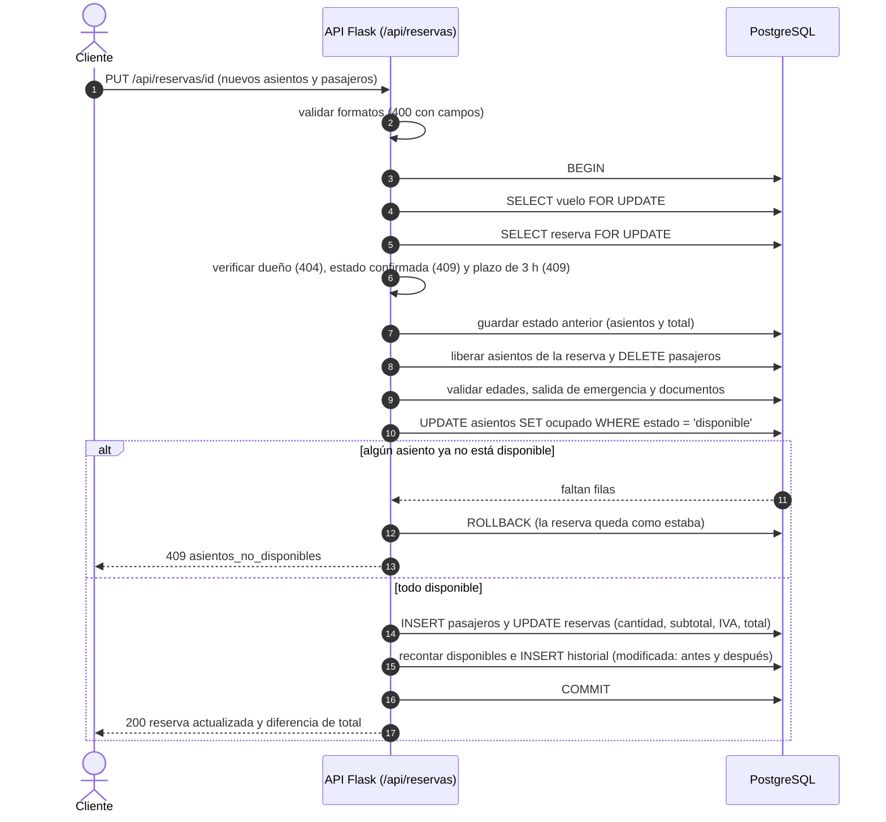

*PNG:* `capturas/diagramas/04c_secuencia_editar_reserva.png` · *fuente:* `docs/04c_secuencia_editar_reserva.mmd`

## 4d. Secuencia: el administrador cancela un vuelo

Cancelar un vuelo cancela en cascada todas sus reservas confirmadas, libera los asientos y registra el evento en el historial.

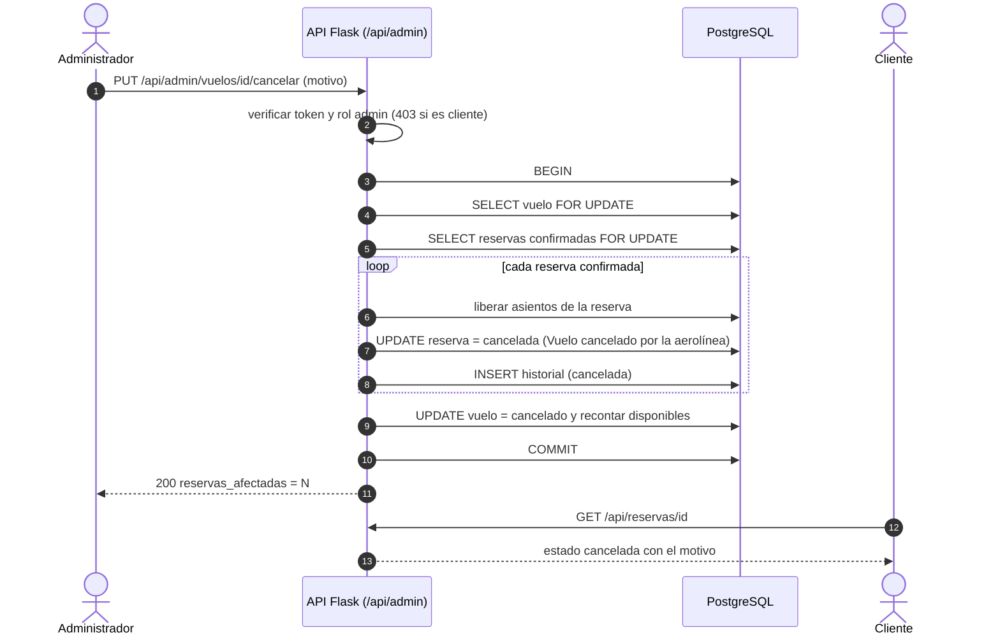

*PNG:* `capturas/diagramas/04d_secuencia_admin_cancela_vuelo.png` · *fuente:* `docs/04d_secuencia_admin_cancela_vuelo.mmd`

## 5. Modelo entidad-relación (9 tablas)

Tablas: `usuarios`, `tokens`, `aeropuertos`, `aviones`, `vuelos`, `reservas`, `asientos`, `pasajeros` e `historial_reservas`. Esquema completo en `backend/sql/schema.sql`.

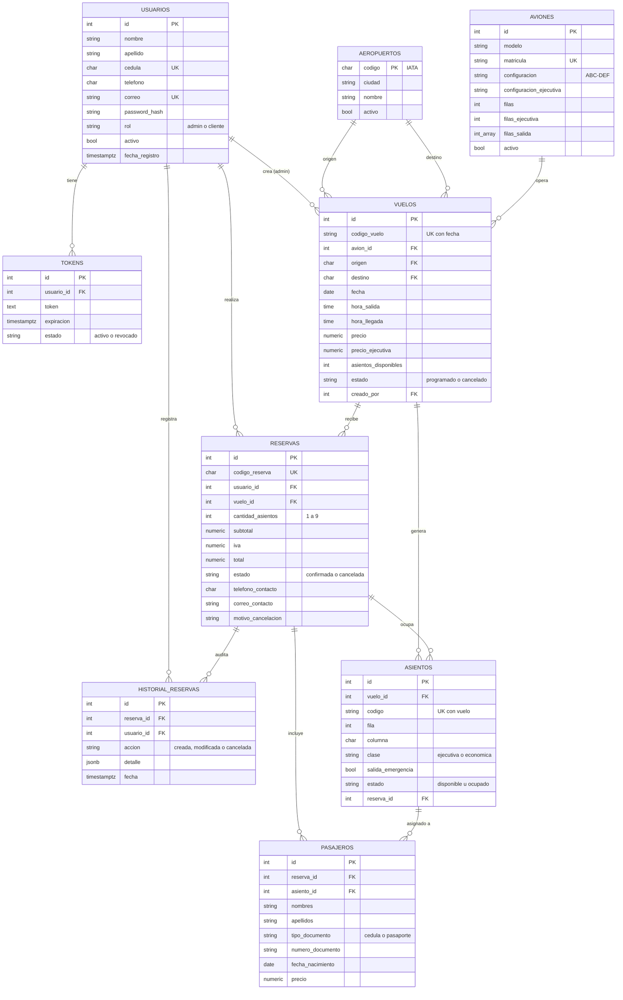

*PNG:* `capturas/diagramas/05_er.png` · *fuente:* `docs/05_er.mmd`

## 6a. Estados de la reserva

Una reserva confirmada puede modificarse varias veces; cancelada es un estado final.

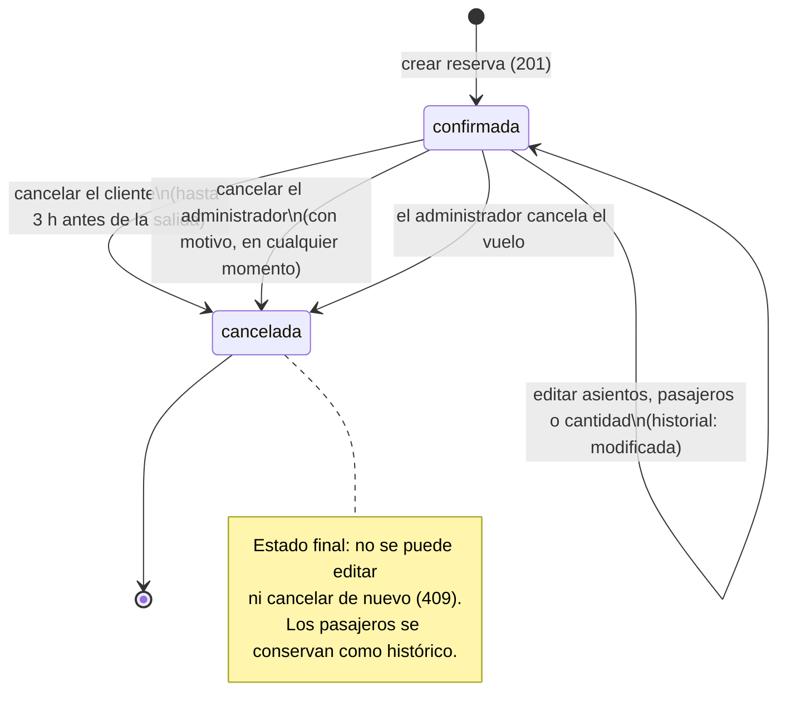

*PNG:* `capturas/diagramas/06a_estados_reserva.png` · *fuente:* `docs/06a_estados_reserva.mmd`

## 6b. Estados del asiento

La restricción `CHECK ((estado = 'ocupado') = (reserva_id IS NOT NULL))` impide asientos ocupados sin reserva.

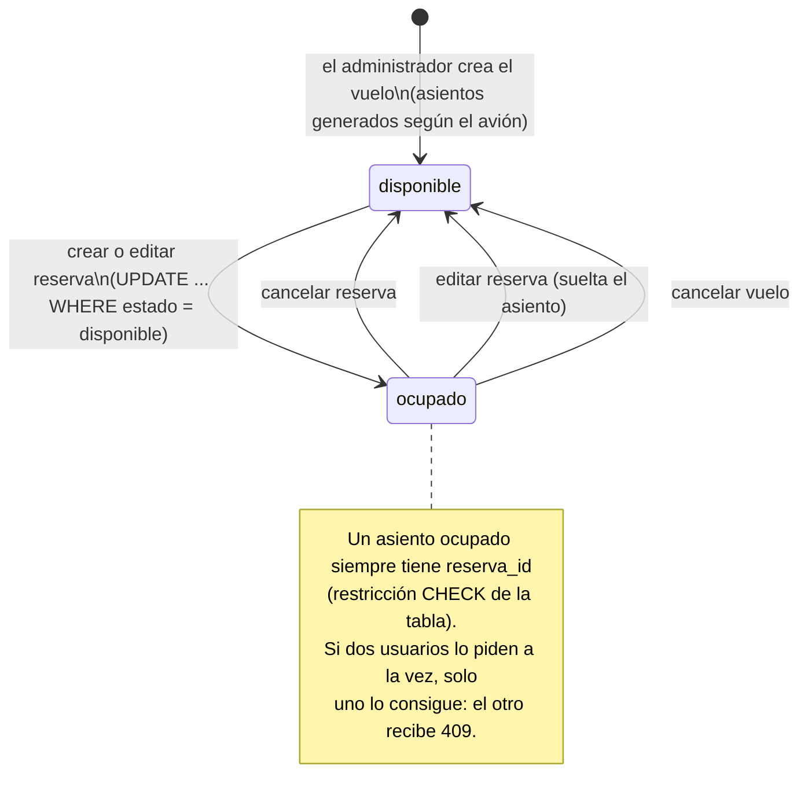

*PNG:* `capturas/diagramas/06b_estados_asiento.png` · *fuente:* `docs/06b_estados_asiento.mmd`

## 7. Despliegue

Los clientes llegan por HTTPS a Render (gunicorn con 2 workers y 4 hilos); Flask se conecta a Supabase (AWS) por el Session pooler con SSL. El código se despliega desde GitHub con el Blueprint `render.yaml`.

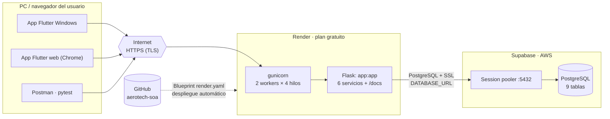

*PNG:* `capturas/diagramas/07_despliegue.png` · *fuente:* `docs/07_despliegue.mmd`
